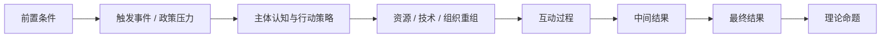

# Mechanism Diagram Brief

用于“文章/段落 → 机制图/路径图”的草图确认与图像生成。先填写 1–8 项并等待用户确认；用户确认后再填写第 9 项并生成图片。

## 1. Source Summary

- 目标文本：
- 研究对象：
- 核心现象：
- 经验反常 / 治理悖论 / 解释缺口：
- 机制图要回答的问题：

## 2. Mechanism Chain

```text
前置条件 → 触发事件 / 政策压力 → 主体认知与策略 → 资源 / 技术 / 组织重组 → 互动过程 → 中间结果 → 最终结果 → 理论命题
```

## 3. Diagram Type

- 推荐图型：因果链 / 多主体互动 / 多维耦合 / 路径模型 / 框架归纳
- 选择理由：
- 不采用的图型及理由：

## 4. Node Table

| 节点 | 图中标签 | 含义 | 来源依据 | 图中位置 | 是否需要用户确认 |
|---|---|---|---|---|---|
| 前置条件 |  |  |  |  | 是 / 否 |
| 触发事件 |  |  |  |  | 是 / 否 |
| 主体策略 |  |  |  |  | 是 / 否 |
| 互动过程 |  |  |  |  | 是 / 否 |
| 中间结果 |  |  |  |  | 是 / 否 |
| 最终结果 |  |  |  |  | 是 / 否 |
| 理论命题 |  |  |  |  | 是 / 否 |

## 5. Draft Diagram



## 6. Reference Transfer Notes

- 范文结构迁移：
- 参考图版式迁移：
- 参考图风格迁移：
- 明确不迁移的内容：

## 7. Figure Caption

- 图题：
- 图注：
- 正文中推荐插入位置：

## 8. Confirmation Questions

- 需要确认的节点：
- 需要确认的关系：
- 需要确认的版式 / 风格：

## 9. Image Generation Prompt And API Request

仅在用户确认草图后填写。

```text
Create an academic mechanism diagram for a public administration / social science paper.

Purpose:
[说明图用于论文机制解释或路径模型]

Language:
[中文 / English]

Diagram content:
[列出确认后的节点、箭头、分组、反馈关系和边界条件]

Layout:
[横版 / 竖版 / 左中右三段 / 上下双层 / 多维耦合框架]

Style:
White background, restrained academic journal style, clean thin lines, clear arrows, high readability, concise labels, balanced spacing, no decorative background, no cartoon style, no 3D effect, no poster-like design.

Reference style:
[概括参考 jpg 的版式、线条、配色和层级，不复制其具体内容]

Constraints:
Only include the confirmed nodes and relationships. Do not invent new concepts. Keep text labels short and legible. Leave enough whitespace for later editing.

Output:
[png / jpeg], [landscape / portrait], suitable for insertion into a manuscript.
```

### API Request

Configuration source:
`config/image-generation.local.json` > environment variables > `config/image-generation.example.json`

```http
POST https://api.openai.com/v1/images/generations
Authorization: Bearer <IMAGE_API_KEY>
Content-Type: application/json
```

```json
{
  "model": "gpt-image-2",
  "prompt": "<paste the confirmed image-generation prompt here>",
  "size": "1536x1024",
  "n": 1
}
```

- API key source:
- Model override:
- Size override:
- Expected response: URL / base64 / other
- Output file name:

## 10. Post-Generation Check

- 节点是否完整：
- 箭头方向是否正确：
- 是否新增了未经确认的内容：
- 文字是否清晰：
- 是否符合论文插图风格：
- 下一轮返修目标：
