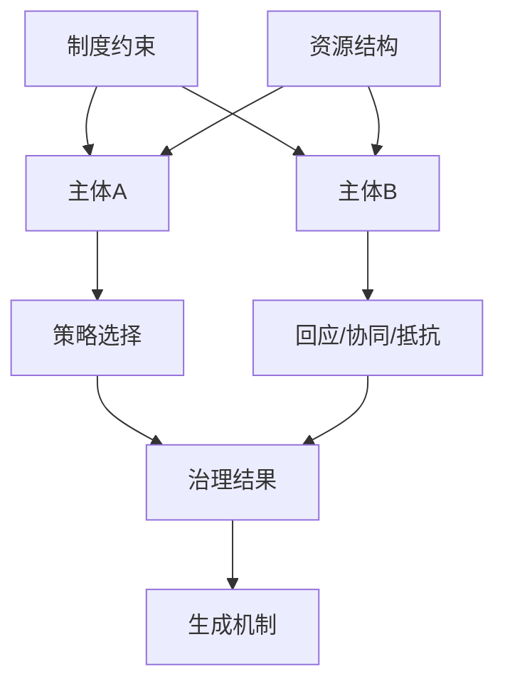

# Mechanism Models（机制模型模板）

用于 Phase 5，把案例发现转化为理论解释。

## 1. 基础因果链

## 2. 主体—资源—制度模型

## 3. 多维耦合模型

| 维度 | 作用位置 | 关键机制 | 支撑材料 | 对结果的影响 |
|---|---|---|---|---|
| 制度维度 | 约束层 |  |  |  |
| 组织维度 | 执行层 |  |  |  |
| 技术/工具维度 | 中介层 |  |  |  |
| 主体行动维度 | 策略层 |  |  |  |

## 4. 理论命题格式

- 命题1：在 [制度/资源/技术条件] 下，[主体] 倾向于通过 [行动策略] 影响 [治理结果]。
- 命题2：[机制A] 与 [机制B] 的耦合，会导致 [预期外结果/效能偏离/协同增强]。
- 边界条件：当 [条件变化] 时，上述机制可能弱化、反转或失效。

## 5. 机制链审计表

机制模型不是因素列表。生成机制图或理论命题前，先填写审计表：

| 机制节点 | 内容 | 材料编号/模拟编号 | 节点功能 | 是否可进入正文 |
|---|---|---|---|---|
| 前置条件 |  |  | 制度/资源/技术/组织条件 | 是/否 |
| 触发事件 |  |  | 解释机制启动原因 | 是/否 |
| 主体判断 |  |  | 呈现行动者认知、压力或目标 | 是/否 |
| 行动策略 |  |  | 呈现协同、规避、转换、整合或抵抗 | 是/否 |
| 主体互动 |  |  | 呈现部门、层级、平台或服务对象互动 | 是/否 |
| 中间结果 |  |  | 避免从原因直接跳到最终结果 | 是/否 |
| 最终结果 |  |  | 治理绩效、效能偏离或制度后果 | 是/否 |
| 理论命题 |  |  | 可抽象为概念、机制、边界或情境贡献 | 是/否 |

缺少主体策略、中间结果或材料编号时，先回到编码分析和证据链矩阵，不直接生成机制模型。
